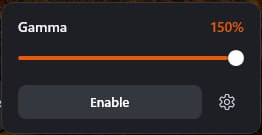
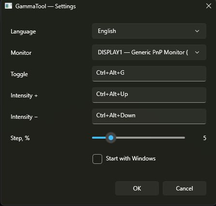

# GammaTool

[English](README.md) · [Русский](README.ru.md)

A Windows 11 tray utility that changes display gamma with one slider. It writes the standard GDI gamma ramp, so it does not depend on an AMD, NVIDIA, or Intel control panel.

The ramp is built on top of the monitor's current one. **0%** is the picture you already have. Values below zero darken it. Values above zero lift the midtones.

| Slider | Gamma |
| --- | --- |
| −50% | 0.5 |
| 0% | 1.0, unchanged |
| 100% | 2.0 |
| 150% | 2.5 |

## Main window

Left-click the tray icon. The panel sits at the bottom-right corner of the monitor under the cursor.



**Enable** turns the ramp on. The same button becomes **Disable** while it is on. The gear opens settings. Click outside the panel, or press Esc, to close it.

The right-click menu contains only **Exit**. Turning gamma on and opening settings are done from this panel.

## Settings



- **Language** — English or Russian. The names stay in their own language so the list is readable either way. OK saves the choice. Cancel restores the previous one.
- **Monitor** — which display receives the ramp. Switching monitors restores the previous one.
- **Toggle**, **Intensity +**, **Intensity −** — click a field and press a shortcut. It must include Ctrl, Alt, or Shift. Backspace clears it. The same shortcut cannot be used for two actions.
- **Step, %** — how far the plus and minus hotkeys move the slider. Holding the key repeats.
- **Start with Windows** — writes the current exe path to the current user's Run key. Put the file in a permanent folder first.

Default shortcuts are Ctrl+Alt+G, Ctrl+Alt+Up, and Ctrl+Alt+Down.

## Install

Download `GammaTool.exe` from the [latest release](https://github.com/tuffii/GammaTool/releases/latest). The .NET runtime is inside the file. Windows does not need the SDK or a separate runtime.

Keep the file somewhere stable, for example `C:\Tools\GammaTool\GammaTool.exe`, then run it. The tray icon is gray while gamma is off and orange while it is on. If SmartScreen warns about the unsigned file, choose **More info**, then **Run anyway**.

Before the first real test, set one registry value from an **administrator** command prompt and reboot:

```bat
reg add "HKLM\SOFTWARE\Microsoft\Windows NT\CurrentVersion\ICM" /v GdiIcmGammaRange /t REG_DWORD /d 256 /f
```

Windows otherwise rejects ramps that bend far from a straight line. GammaTool's range, 0.5 to 2.5, needs this. The program never writes to HKLM and does not need to run as administrator.

Remove the value later with:

```bat
reg delete "HKLM\SOFTWARE\Microsoft\Windows NT\CurrentVersion\ICM" /v GdiIcmGammaRange /f
```

Check the result in **SDR**. With HDR enabled, the ramp usually does nothing. If two adjustments stack and the picture is too bright, turn off Custom Color in the GPU control panel.

A virtual machine is enough to check the window, hotkeys, and settings. The gamma change itself has to be checked on a physical PC: virtual adapters such as QXL accept the call and leave the picture alone.

## What it keeps safe

- Exit restores the original ramp. The same happens if the process is killed and then started again.
- A display-mode change, wake from sleep, or unlocking the session reapplies the current setting.
- There are no network calls and no telemetry.
- Saturation, color temperature, game profiles, and overlays are out of scope.

## Build

The project targets `net10.0-windows` and cross-compiles on Linux. You need the [.NET SDK 10](https://dotnet.microsoft.com/download).

```bash
dotnet build -c Release
dotnet publish -c Release -r win-x64 --self-contained true \
  -p:PublishSingleFile=true \
  -p:IncludeNativeLibrariesForSelfExtract=true \
  -p:EnableCompressionInSingleFile=true
```

The file to copy is `bin/Release/net10.0-windows/win-x64/publish/GammaTool.exe`.

Tagged versions are published by GitHub Actions. Pushing a `v*` tag builds this same exe on a Windows runner and attaches it to the release.
