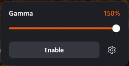
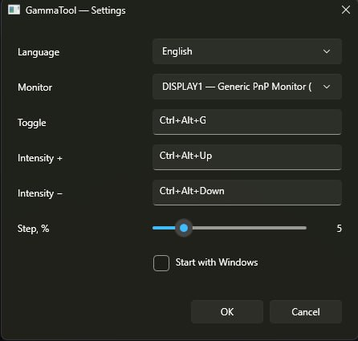

# GammaTool

[English](README.md) · [Русский](README.ru.md)

Минималистичная утилита для Windows 11, которая настраивает гамму монитора. Изменения записываются через GDI гамма-рампу.



## Диапазон гаммы

| Ползунок | Гамма |
| --- | --- |
| −50% | 0.5 |
| 0% | 1.0 (без изменений) |
| 100% | 2.0 |
| 150% | 2.5 |

0% — это текущая картинка. Отрицательные значения её затемняют, положительные осветляют середину.

## Использование

- Левый клик по значку в трее открывает панель. Двигайте ползунок мышью или колёсиком.
- **Включить** / **Выключить** — включает или выключает настройку.
- Шестерёнка открывает настройки.
- Правый клик по значку в трее — пункт **Выход**.



**Настройки**

- **Language**: English или Русский.
- **Монитор**: какой дисплей настраивать.
- **Вкл / выкл, Интенсивность +, Интенсивность −**: кликните в поле и нажмите сочетание с Ctrl, Alt или Shift. Backspace очищает поле. Сочетания не должны повторяться.
- **Шаг, %**: на сколько меняется ползунок по сочетаниям интенсивности. При удержании клавиши шаг повторяется.
- **Запускать вместе с Windows**: добавляет путь к текущему exe в автозагрузку.

Сочетания по умолчанию: `Ctrl+Alt+G` — вкл/выкл, `Ctrl+Alt+Up` и `Ctrl+Alt+Down` — интенсивность.

## Установка

1. Скачайте `GammaTool.exe` из [последнего релиза](https://github.com/tuffii/GammaTool/releases/latest). Рантайм .NET уже внутри, ничего ставить не нужно.
2. Положите файл в постоянную папку, например `C:\Tools\GammaTool\`. Автозапуск привязан к этому пути.
3. Запустите. Если SmartScreen ругается на неподписанный файл, выберите **Подробнее → Выполнить в любом случае**.

### Обязательное значение реестра

Без этого значения Windows отклоняет гамма-рампы, которые сильно отходят от прямой. Выполните один раз в **командной строке от администратора** и перезагрузитесь:

```bat
reg add "HKLM\SOFTWARE\Microsoft\Windows NT\CurrentVersion\ICM" /v GdiIcmGammaRange /t REG_DWORD /d 256 /f
```

Откат:

```bat
reg delete "HKLM\SOFTWARE\Microsoft\Windows NT\CurrentVersion\ICM" /v GdiIcmGammaRange /f
```

Сама программа не требует прав администратора и HKLM не меняет.

### Заметки

- Проверяйте в SDR. При включённом HDR рампа обычно игнорируется.
- Если картинка стала слишком яркой, проверьте, не меняет ли её панель видеокарты (например, AMD Custom Color).
- Виртуальная машина подходит для окна, хоткеев и настроек. Виртуальные адаптеры вроде QXL принимают рампу, но картинку не меняют, поэтому эффект проверяйте на физическом мониторе.

## Поведение

- При выходе восстанавливается исходная рампа. То же происходит после аварийного завершения при следующем запуске.
- После сна, разблокировки сессии или смены видеорежима текущее значение применяется снова.
- Сети и телеметрии нет.

## Сборка

Нужен [.NET SDK 10](https://dotnet.microsoft.com/download). Проект собирается из Linux.

```bash
dotnet publish -c Release -r win-x64 --self-contained true \
  -p:PublishSingleFile=true \
  -p:IncludeNativeLibrariesForSelfExtract=true \
  -p:EnableCompressionInSingleFile=true
```

Результат: `bin/Release/net10.0-windows/win-x64/publish/GammaTool.exe`.

Push тега `v*` запускает `.github/workflows/release.yml`: exe собирается на Windows и прикрепляется к релизу на GitHub.
